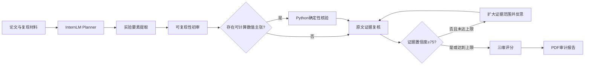

# ReproAgent：基于书生大模型与 LangGraph 的科研论文可复现性审计智能体

> 参赛方向：开放赋能智能体  
> 应用体验链接：部署完成后填写固定 `streamlit.app` 地址  
> 演示视频链接：录制后填写网盘地址（建议设置长期有效、免登录访问）

## 一、项目摘要

科研论文复现通常需要研究者人工查找数据来源、实验参数、软件环境、代码入口和结果证据，并重新核算论文中的关键数值。该过程耗时长、标准不统一，且通用大模型容易把“未公开代码”等资源开放性问题误判为科学结论不可信。

ReproAgent 以书生 Intern-S2 为模型底座，以 LangGraph 为智能体 harness，将实验要素提取、可复现性初审、确定性数值核验、原文证据复核、反思式证据扩展和 PDF 报告生成编排成可运行闭环。系统对论文原文和模型输出进行不可信数据处理，对可计算结论交由 Python 工具核验，并将“科学可复现性”“资源开放性”“审计置信度”分开评分，降低单一总分带来的误导。

## 二、真实痛点与用户

### 2.1 目标用户

- 科研团队：投稿前检查实验描述和结果一致性。
- 期刊编辑与审稿人：快速定位复现风险和证据页码。
- 高校科研管理人员：批量形成规范化审计线索。
- 复现研究者：建立复现实验准备清单。

### 2.2 核心痛点

1. 论文信息分散在正文、表格、公式和附录中，人工整理成本高。
2. 百分比、差值、变化率等结论容易出现基准混乱，语言模型心算不稳定。
3. “代码未公开”不等于“论文科学结果错误”，传统评分容易混淆维度。
4. 大模型结论可能缺少原文证据，难以审计和追溯。
5. 通用对话无法呈现任务规划、条件路由、工具调用和失败恢复过程。

## 三、解决方案

### 3.1 输入与输出

输入：科研论文 PDF；可选上传代码、README、依赖清单或 ZIP 复现材料。  
输出：实验要素结构化结果、确认问题、过滤误报、原文页码证据、确定性数值核验结果、三维评分和正式 PDF 审计报告。

### 3.2 智能体工作流

### 3.3 工具编排

| 工具 | 作用 | 确定性 |
|---|---|---|
| `experiment_extractor` | 提取研究目标、数据、方法、参数、指标和证据 | 模型推理 |
| `reproducibility_auditor` | 发现缺失项、矛盾和证据风险 | 模型推理 |
| `numeric_verifier` | 重新计算比例、差值和变化率 | Python确定性 |
| `evidence_verifier` | 回查原文、过滤误报、合并重复问题 | 模型推理 + 规则 |
| `pdf_report_generator` | 输出正式中文审计报告 | 确定性 |

## 四、技术创新

### 4.1 混合智能核验

语言模型负责语义理解和候选问题发现，Python 工具负责数值计算。数值核验结果作为证据再次进入复核节点，避免把模型心算直接作为审计结论。

### 4.2 置信度门控与反思回环

系统根据问题覆盖率和证据质量计算本轮置信度。低于阈值时自动扩大原文检查范围，重新检索相关表格、公式、参数定义和前后文，最多反思两轮，避免无限循环。

### 4.3 三分制评价

- 科学可复现性：数据、方法、参数、环境和结果一致性。
- 资源开放性：代码、数据和运行环境的公开程度。
- 审计置信度：页面覆盖、证据完整、数值工具状态和文本可读性。

未上传代码只影响资源开放性；只有当代码缺失导致关键方法无法重建时，才影响科学可复现性。

### 4.4 安全静态检查

系统仅读取复现材料文件名与 ZIP 目录，不解压、不导入、不执行代码。论文原文中出现的命令、提示词或要求改变任务的文字均作为待分析内容，而不是系统指令。

## 五、工程实现

| 层次 | 技术 |
|---|---|
| 模型底座 | 上海人工智能实验室书生 Intern-S2 |
| Harness | LangGraph |
| 智能体工具 | Python Tool Registry |
| Web 应用 | Streamlit |
| PDF 解析 | PyMuPDF |
| 报告生成 | ReportLab |
| 部署 | Streamlit Community Cloud / Docker |
| 自动化验收 | unittest、部署预检、GitHub Actions |

公网版本限制 PDF 最大 50 MB、最多 500 页、可提取文本最多 200 万字符；复现材料总大小最大 20 MB。API 密钥仅通过云端 Secrets 注入。

## 六、评测方案

### 6.1 测试集构成

建议最终准备不少于 20 篇公开论文：数值模拟、机器学习、实验研究和理论研究各 5 篇。每篇由两名评审者独立标注实验要素与问题证据，冲突项经协商形成金标准。

### 6.2 指标

| 评测项 | 指标 | 目标值 |
|---|---|---:|
| 实验要素提取 | 字段准确率 / 证据页码准确率 | ≥85% / ≥80% |
| 问题发现 | Precision / Recall / F1 | ≥80% / ≥75% / ≥77% |
| 数值核验 | 可支持操作上的计算正确率 | 100% |
| 误报过滤 | 误报下降比例 | ≥30% |
| 稳定性 | 同一输入三次运行结构化字段一致率 | ≥90% |
| 效率 | 相比人工基线的平均耗时降低 | ≥70% |
| 可用性 | 端到端成功率 | ≥95% |

### 6.3 消融实验

1. 去除 Python 数值工具：比较数值错误率。
2. 去除证据复核：比较误报率。
3. 去除反思回环：比较低证据问题的召回率。
4. 使用单一总分：展示与三分制在解释性上的差异。

> 上述目标值必须在最终答辩前用真实测试数据替换，不得把计划值写成已达到的成绩。

## 七、可复现交付

项目提供：完整源代码、固定依赖、`.env.example`、Streamlit 配置、Dockerfile、自动化测试、GitHub Actions、部署预检脚本、安全说明和部署说明。任何人获得自己的书生 API 密钥后，可按 README 在 Python 3.12 环境运行。

## 八、局限性与后续工作

- 扫描型 PDF 暂未集成 OCR，文本为空时只给出可读性警告。
- 当前确定性工具覆盖比例、差值、变化率和比值，不执行论文上传的任意代码。
- 审计结论属于复现风险线索，不替代领域专家审稿或科研诚信调查。
- 后续计划增加多模态图表解析、引用级证据定位、批量评测集和人工反馈闭环。

## 九、五分钟演示视频脚本

### 0:00–0:30 痛点

说明人工复现审查需要跨页查找参数、环境和结果，通用对话模型又容易心算出错、证据不可追溯。

### 0:30–1:00 架构

展示侧栏中的 Intern-S2 和 LangGraph 状态，展开智能体架构图，强调条件路由、Python 数值工具和反思回环。

### 1:00–1:30 输入

上传演示论文和可选复现材料，点击“解析论文”，展示页数、字符数、代码文件、README 和依赖清单统计。

### 1:30–3:20 智能审计

点击“启动智能审计”，展示 Planner 计划、实时节点状态、工具调用轨迹和反思次数。重点展示一个“模型初审提出问题、Python 工具重算、证据复核确认或驳回”的完整链路。

### 3:20–4:20 结果

展示科学可复现性、资源开放性和审计置信度三个分数，解释未上传代码不会无条件降低科学分。打开确认问题，展示页码、原文证据、计算过程和改进建议。

### 4:20–4:50 报告

下载并打开 PDF 审计报告，展示中文、科学记数法、页码证据和结构化结论。

### 4:50–5:00 总结

总结“模型理解 + 工具核验 + 证据回查 + 可追溯报告”的闭环，并展示固定公网体验链接。
